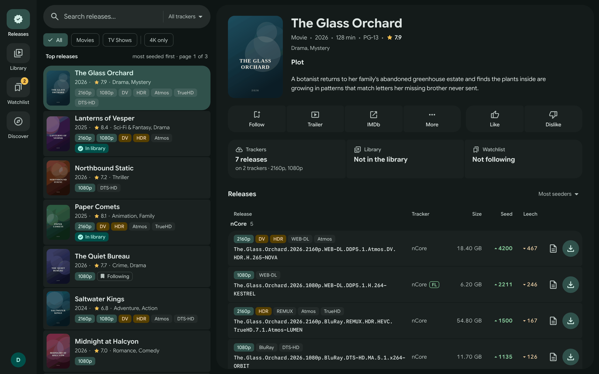
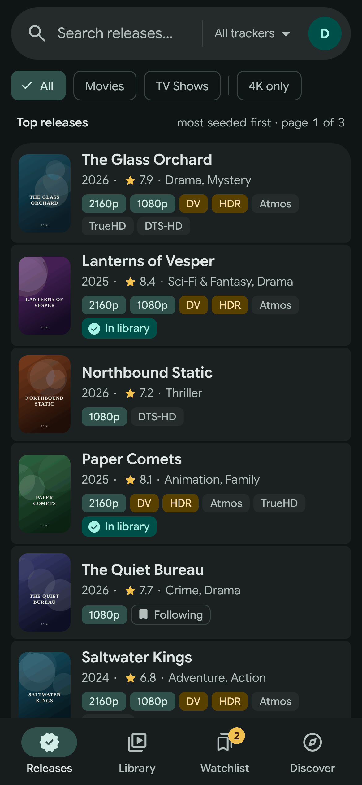

# Release Manager

[](https://github.com/misomarcell/release-manager/actions/workflows/checks.yml)
[](LICENSE)

A self-hosted web app for finding movie and TV releases on your trackers, enriched with TMDB metadata, and sending them to qBittorrent.

<p align="center">
  
  
</p>
<p align="center"><sub>Screenshots use made-up titles and placeholder posters.</sub></p>

> This project only talks to services you configure yourself and ships no content. You are responsible for using it in line with the laws that apply to you and the terms of the services you connect.

## Features

- **Tracker plugins**: search nCore and The Pirate Bay together; releases are grouped under one title
- **TMDB enrichment**: posters, ratings, genres, plots and trailers, cached in PostgreSQL for a week
- **Downloads**: send a release to qBittorrent with a suggested save path
- **Library**: your Jellyfin library, with media info and per-season episode counts
- **Watchlist**: follow titles and get a badge when new releases (optionally matching keywords) appear
- **Discover**: trending titles and optional AI-powered recommendations (OpenAI)
- **Passkey authentication**: WebAuthn/FIDO2 login, no passwords
- **Settings page**: service connections and schedules can be changed without a restart
- **Light and dark theme**: Angular Material 3, following the device colour scheme

## Tech Stack

| Layer    | Technology                        |
| -------- | --------------------------------- |
| Frontend | Angular 22, Material 3, SSR       |
| Backend  | Express 5, TypeScript, Node.js 26 |
| Database | PostgreSQL 17                     |
| Auth     | WebAuthn (SimpleWebAuthn)         |
| Tooling  | pnpm workspaces                   |
| Deploy   | Docker Compose                    |

## Requirements

- Docker with Docker Compose, or Node.js 26 (see `.nvmrc`) and pnpm (`npm install -g pnpm`) for development
- A [TMDB](https://www.themoviedb.org/settings/api) API read access token
- An account on at least one supported tracker (nCore needs your cookie credentials; The Pirate Bay needs none)
- Optional: qBittorrent with the Web UI enabled, Jellyfin, an OpenAI API key
- HTTPS in front of the app for anything other than `localhost`, since passkeys only work on a secure origin

## Quick Start (Docker)

```bash
# 1. Configure
cp .env.example .env
# Edit .env: tracker credentials, TMDB access token, and RP_ID / RP_ORIGIN / NG_ALLOWED_HOSTS
# if the app is opened on anything other than http://localhost:8085

# 2. The backend joins an external Docker network shared with qBittorrent
docker network create media

# 3. Start everything
docker compose up -d

# 4. Open http://localhost:8085
```

When the app is served on a public host name, put it behind a reverse proxy with HTTPS (passkeys require a secure origin) and set:

```bash
RP_ID=releases.example.com
RP_ORIGIN=https://releases.example.com
NG_ALLOWED_HOSTS=releases.example.com
```

PostgreSQL and pgAdmin are published on `127.0.0.1` only and use default development credentials. Change them in `docker-compose.yml` before exposing either beyond the host.

## Updating (after git pull)

```bash
docker compose build --no-cache backend frontend && docker compose up -d
```

## Development Setup

```bash
# Install dependencies (requires pnpm, version pinned via `packageManager` in package.json)
pnpm install

# Start PostgreSQL and pgAdmin (database UI)
docker compose up db pgadmin -d

# Start backend (port 3000)
pnpm start:backend

# Start frontend (port 4200, proxies /api to backend)
pnpm start
```

For local development point `DATABASE_URL` in `.env` at `localhost` instead of `db`.

### pgAdmin (Database UI)

pgAdmin is included for managing PostgreSQL during development.

- **URL:** http://localhost:5050
- **Email:** `admin@local.dev`
- **Password:** `admin`

To connect to the database, register a new server in pgAdmin:

| Field                | Value      |
| -------------------- | ---------- |
| Host                 | `db`       |
| Port                 | `5432`     |
| Maintenance database | `movieapp` |
| Username             | `movieapp` |
| Password             | `movieapp` |

## Environment Variables

| Variable                  | Description                                                             | Default                                         |
| ------------------------- | ----------------------------------------------------------------------- | ----------------------------------------------- |
| `DATABASE_URL`            | PostgreSQL connection string                                            | `postgres://movieapp:movieapp@db:5432/movieapp` |
| `SETTINGS_ENCRYPTION_KEY` | Encrypts secrets saved on the Settings page (`openssl rand -base64 32`) | —                                               |
| `RP_ID`                   | WebAuthn relying party ID: the host name the app is opened on           | `localhost`                                     |
| `RP_ORIGIN`               | Allowed origins for WebAuthn, comma-separated                           | `http://localhost:8085`                         |
| `NG_ALLOWED_HOSTS`        | Host names the frontend answers to, comma-separated                     | `localhost`                                     |
| `NCORE_BASE_URL`          | nCore base URL                                                          | `https://ncore.pro`                             |
| `NCORE_USERNAME`          | nCore cookie username                                                   | —                                               |
| `NCORE_COOKIE_PASS`       | nCore cookie password                                                   | —                                               |
| `APIBAY_BASE_URL`         | The Pirate Bay API base URL                                             | `https://apibay.org`                            |
| `TMDB_ACCESS_TOKEN`       | TMDB API read access token                                              | —                                               |
| `QBITTORRENT_URL`         | qBittorrent Web UI URL                                                  | —                                               |
| `QBITTORRENT_USERNAME`    | qBittorrent username                                                    | `admin`                                         |
| `QBITTORRENT_PASSWORD`    | qBittorrent password                                                    | —                                               |
| `DOWNLOAD_PATH_MOVIES`    | Save path for movies                                                    | `/media/Movies`                                 |
| `DOWNLOAD_PATH_TV`        | Save path for TV shows                                                  | `/media/TV_Shows`                               |
| `JELLYFIN_URL`            | Jellyfin server URL                                                     | —                                               |
| `JELLYFIN_API_KEY`        | Jellyfin admin API key                                                  | —                                               |
| `JELLYFIN_USER_ID`        | Jellyfin user to scope the library sync to                              | —                                               |
| `OPENAI_API_KEY`          | OpenAI API key for AI recommendations                                   | —                                               |
| `GITHUB_REPO`             | Repository shown as the app version                                     | `misomarcell/release-manager`                   |
| `GITHUB_TOKEN`            | GitHub token for the version check (only needed for a private repo)     | —                                               |
| `QBITTORRENT_CRON`        | qBittorrent torrent sync cron schedule                                  | `0 6 * * *`                                     |
| `JELLYFIN_CRON`           | Jellyfin library sync cron schedule                                     | `0 6 * * *`                                     |
| `WATCHLIST_CRON`          | Watchlist release check cron schedule                                   | `0 9 * * *`                                     |

Everything from `NCORE_BASE_URL` down is only a starting value and can be changed on the Settings page. Never commit your `.env`.

## Authentication

1. Register a passkey at the login page
2. Activate the first account and make it an admin:
   ```bash
   docker compose exec db psql -U movieapp -c "UPDATE users SET valid = true, admin = true WHERE username = 'you';"
   ```
3. Log in with your passkey. Further accounts are activated on the Manage Users page.

## Project Structure

```
├── backend/          # Express API server
│   └── src/
│       ├── routes/        # API endpoints
│       ├── services/      # Business logic, tracker plugins, integrations
│       ├── repositories/  # Database access
│       ├── middleware/    # Auth and request validation
│       ├── utils/         # Helpers
│       └── db/            # PostgreSQL connection and schema
├── web/              # Angular frontend (SSR)
│   └── src/app/
│       ├── components/    # Pages, sheets and shared UI
│       ├── services/      # API and state services
│       └── guards/        # Route guards
├── shared/           # TypeScript models shared by both
├── docker-compose.yml
├── Dockerfile
└── .env.example
```

`AGENTS.md` describes the architecture in detail; `DESIGN.md` covers the visual system.

## Validation

```bash
pnpm validate   # format check + lint + build + knip
```

GitHub Actions runs the same checks on every pull request to `master` and on pushes to `master`.

## Contributing

Issues and pull requests are welcome. Please run `pnpm validate` before opening a pull request; `AGENTS.md` describes the architecture and the conventions the code follows (lint limits, formatting, how trackers plug in).

## Security

Please do not report security problems in public issues. Use **Report a vulnerability** on the repository's Security tab instead.

## License

[MIT](LICENSE)
